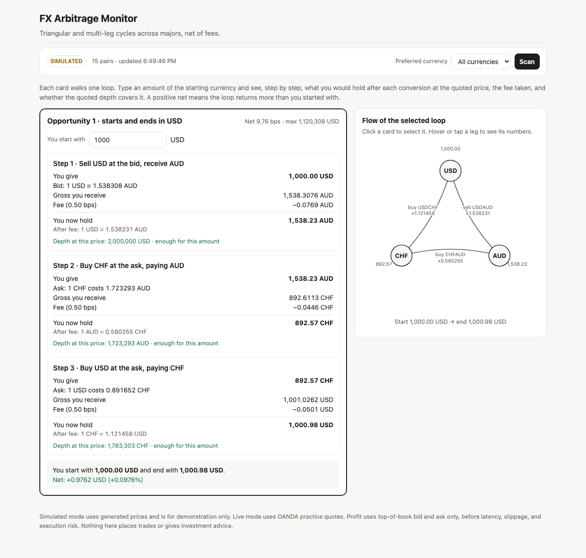
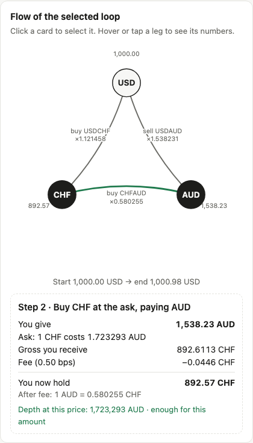
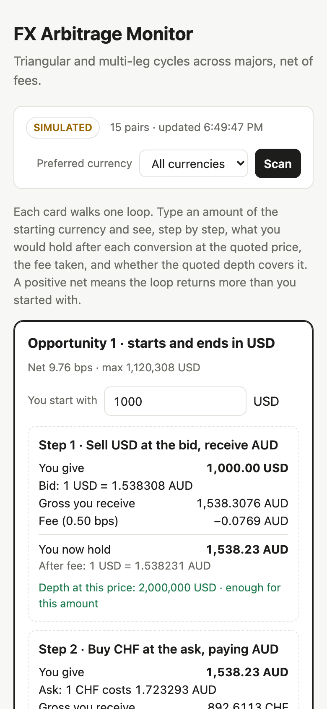

# FX Arbitrage Monitor

A small system that looks for **multi-leg FX arbitrage** (triangular and longer loops such as CHF → USD → AUD → CHF) across 13 currencies (78 pairs), using bid/ask quotes and fees. It includes:

- a detector built on Bellman-Ford over a currency graph,
- a replay tool for recorded quote files,
- an OANDA practice-account adapter for real prices and liquidity,
- a Vercel-hosted web page that scans on demand and shows each loop step by step, with an interactive flow diagram.

> **Not financial advice.** This is a research and learning project. It does not place trades. Profit figures use top-of-book quotes only and ignore latency, slippage, financing, and execution risk. Cross-rate arbitrage among major pairs is quickly closed by professional market makers, so most real opportunities will be smaller than the costs.

## Screenshots

**Desktop.** Each card is one loop. The amount box recalculates every step as you type. The flow panel on the right draws the selected loop.



**Flow panel.** Hover or tap a leg to see its numbers: price, gross and net amounts, fee, and whether the quoted depth covers the amount.



**Mobile.** The layout stacks to a single column with no horizontal scrolling.



## How it works

1. **Graph.** Each currency is a node. Converting from one currency to another is an edge priced at what you actually get: the **bid** when selling the base, or **1 / ask** when buying the base. Fees are applied per leg.
2. **Cycle search.** Edges are weighted with `-log(rate)`. A loop whose rates multiply to more than 1 is a negative cycle, which Bellman-Ford finds.
3. **Pricing.** Each cycle is walked with a starting amount to get the profit in basis points and the largest notional the top-of-book depth supports.
4. **Presentation.** The web page shows the cycle as cards with a step-by-step breakdown, plus an interactive diagram of the loop.

The currency universe is USD, EUR, GBP, JPY, CHF, AUD, CAD, NZD, NOK, SEK, SGD, ZAR, and INR: 13 currencies and 78 pairs. Because the detector only uses the best bid and ask for each pair, it is fast: a scan takes about 130 µs for 78 pairs in local tests.

## Supported currencies

| Currency | Name | Currency | Name |
| --- | --- | --- | --- |
| USD | US dollar | SGD | Singapore dollar |
| EUR | Euro | ZAR | South African rand |
| GBP | Pound sterling | INR | Indian rupee |
| JPY | Japanese yen | CAD | Canadian dollar |
| CHF | Swiss franc | NOK | Norwegian krone |
| AUD | Australian dollar | SEK | Swedish krona |
| NZD | New Zealand dollar | | |

The simulated feed uses the starting USD values in `START_VALUE` in `fx_arb/synth.py`. To add a currency, add one entry there, add its option to the dropdown in `index.html`, and check that the OANDA account offers its pairs. Pairs the account doesn't offer are skipped.

## Repository layout

```
fx_arb/                  Python package
  detector.py            graph building, cycle search, cycle pricing
  quotes.py              Quote type and CSV read/write
  replay.py              replay recorded quotes; reports new opportunities
  synth.py               synthetic quote generator with injected mispricings
  oanda.py               OANDA v20 pricing adapter (live feed)
  tests/                 pytest suite
api/scan.py              Vercel Python function: GET /api/scan[?currency=EUR]
index.html               single-page UI (no build step, no dependencies)
docs/                    screenshots used in this README
```

## Quick start

Requirements: Python 3.10+ and, for the tests, `pytest`.

```bash
# Run the unit tests
python3 -m pip install pytest
python3 -m pytest fx_arb/tests

# Generate synthetic quotes with a few injected mispricings
python3 -m fx_arb.synth quotes.csv --ticks 5000 --seed 1

# Replay them through the detector
python3 -m fx_arb.replay quotes.csv --fee-bps 0.25 --min-bps 1
```

CSV columns: `ts,base,quote,bid,ask,bid_size,ask_size`. Prices are quote per unit of base (EURUSD = 1.10). Sizes are in base units. `ts` is epoch seconds.

The detector also runs directly from Python:

```python
from fx_arb.detector import ArbDetector
from fx_arb.quotes import Quote

book = {"EURUSD": Quote(ts, "EUR", "USD", 1.1000, 1.1002, 1e6, 1e6), ...}
for opp in ArbDetector(fee_bps=0.5, min_profit_bps=0.5).scan(book, now=ts):
    print(opp.path, round(opp.profit_bps, 2), round(opp.max_notional))
```

## Running the website locally

The API and the page are served by the same function, so the simplest local check is a small server that serves `index.html` and calls `api/scan.py`. Without OANDA credentials it returns **simulated** quotes, clearly labelled as such.

To use live prices, see the next section.

## Live data (OANDA practice)

The live feed uses [OANDA's v20 REST API](https://developer.oanda.com/rest-live-v20/introduction/) with a free **practice** account. Set these environment variables:

| Variable | Required | Meaning |
| --- | --- | --- |
| `OANDA_TOKEN` | for live | Personal access token from the OANDA practice account |
| `OANDA_ACCOUNT_ID` | for live | Practice account ID |
| `OANDA_ENV` | no | `practice` (default) or `live` |
| `FEE_BPS` | no | Fee per leg in basis points (default `0.5`) |
| `MAX_AGE_S` | no | Ignore quotes older than this many seconds (default `5`) |

Without `OANDA_TOKEN` and `OANDA_ACCOUNT_ID`, the function falls back to simulated data. The page labels which mode it is in.

The live feed asks OANDA which instruments the account offers and keeps the pairs among our 13 currencies. Pairs the account doesn't offer, such as some INR crosses, are skipped automatically. That list is cached for an hour.

**Assumptions to verify against a live response:**

- OANDA's liquidity field is treated as units of the base currency. Check this before trusting `max_notional`.
- The instrument-list response (`/v3/accounts/{id}/instruments`) is read as a list of objects with `name` and `type` fields, with `type` equal to `CURRENCY`. This is from OANDA's documentation, not a live response. If the live scan returns no pairs, check this first.
- Which of the 13 currencies have pairs on OANDA. INR and some others may not be offered, so they may be skipped on the live feed.

## Deploying to Vercel

The repo is set up for Vercel's Python runtime with no build step and no third-party Python dependencies.

```bash
npx vercel login
npx vercel deploy --prod
```

Add the OANDA variables under the project's environment settings (or with `npx vercel env add OANDA_TOKEN production`), then redeploy.

## Design notes

- **Scan on snapshots, not on every tick.** Scanning after each individual quote compares pairs from different moments and reports phantom arbitrage. The replay groups quotes by timestamp for this reason, and a live feed needs an equivalent window. In a test with clean synthetic data, snapshot scanning found zero opportunities, as it should.
- **Depth is top-of-book only.** `max_notional` is the largest starting amount that fits the best quoted size on every leg. It does not model order-book depth beyond the top level.
- **The page does not poll.** It calls the API only when you press **Scan**. Typing a new amount recalculates locally from the data already loaded.

## Limitations

- Simulated data is for demonstration only.
- No slippage, latency, financing, or transaction-cost model beyond a flat fee per leg.
- No execution layer. Nothing here sends orders.
- The OANDA liquidity units, the instrument-list format, and the set of INR pairs have not been checked against a live response (see Live data above).
- Currency coverage on the live feed depends on what the account offers.

## License

No license has been chosen yet. Until one is added, all rights are reserved by the author.
